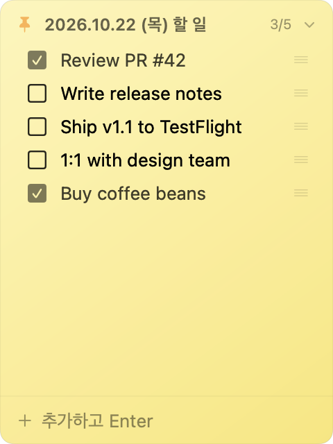

# Todo Sticker

A tiny, always-on-top sticky-note todo widget for macOS that lives in the menu bar. One Swift file, no Xcode project, no dependencies, with optional two-way sync to a Notion database.

**English** · [한국어](#한국어) · [日本語](#日本語)

<p align="center">
  
</p>

## Features

- **Menu bar icon**: click to show or hide the widget. Right-click for a menu (show/hide, sync now, quit).
- **Checklist**: checkbox on the left, inline-editable text, completed items dimmed, and an open/total counter in the header.
- **Drag to reorder** rows. **Hover** a row to reveal ✕ for deleting it.
- **Quick add**: type in the field at the bottom and press Enter.
- **Sticky-note window**: floats above other windows on every Space (including full-screen apps). It doesn't steal focus, and you can drag it anywhere or resize it from the edges.
- **Collapse**: double-click the title bar to fold the note down to a single line, with an animated transition.
- **Dated header**: shows today's date and rolls over automatically at midnight.
- **Autosave**: window position, size, collapsed state and the list itself all persist.
  Data lives in `~/Library/Application Support/TodoSticker/todos.json`.
- **Notion sync (optional)**: two-way sync with a daily page in a Notion database. Unfinished items carry over to the next day automatically. See [Notion sync](#notion-sync-optional).

## Requirements

- macOS 13 Ventura or later (`LSMinimumSystemVersion` 13.0)
- Swift 5.9+ toolchain: Xcode or just the Command Line Tools (`xcode-select --install`)
- Tested with Swift 6.1.2 on macOS 15.3 (Apple Silicon)

## Build & run

```bash
./build.sh
open "Todo Sticker.app"
```

`build.sh` compiles `main.swift` with `swiftc -O`, copies the binary into the `.app` bundle and ad-hoc code-signs it.

To launch it at login, go to **System Settings → General → Login Items → +** and add `Todo Sticker.app`.

## Notion sync (optional)

Create `~/Library/Application Support/TodoSticker/notion.json`:

```json
{ "token": "<Notion integration secret>", "databaseId": "<database id>" }
```

The database needs a title property named `제목` and a date property named `날짜`, and it must be shared with your integration. Each day the app looks up or creates that day's page (titled `YYYYMMDD 해야할일`) and syncs its `to_do` blocks. When it creates a new page, it copies over the unchecked items from the most recent previous page. Without `notion.json`, the app is purely local. The status icon in the header shows sync state.

## How it works

The whole app is a single file, [`main.swift`](main.swift) (~780 lines), organized with `MARK` sections:

| Section | What it does |
| --- | --- |
| Model | `Todo` / `TodoStore`, an `ObservableObject` that writes JSON atomically on every change. It also reads the older plain-array format. |
| Notion API | A thin `async/await` wrapper over `URLSession` for the Notion REST API: query, create page, list/append/update/delete blocks, with pagination and 100-item chunking. |
| Sync Engine | A `@MainActor` loop that runs every 3 s. Local changes are pushed first (deletes, reorder, edits, new items), then remote changes are pulled about every 30 s. A pull is skipped while you are typing so it doesn't overwrite your input. |
| Views | SwiftUI: `List` with `.onMove` for reordering, `@FocusState` for the input field, and a gradient "paper" background. |
| Panel / App Delegate | AppKit hosting: `NSStatusItem`, a borderless `.nonactivatingPanel` `NSPanel` at `.floating` level with `canJoinAllSpaces`, `setFrameAutosaveName` to remember its frame, and `NSAnimationContext` for the collapse/expand animation. |
| Entry point | `NSApplication` with `.accessory` activation policy (no Dock icon). `LSUIElement` is also set in `Info.plist`. |

Design notes:

- **No Xcode project.** `Todo Sticker.app/Contents/Info.plist` is the only hand-written bundle file. `build.sh` produces the rest.
- **SwiftUI inside AppKit.** SwiftUI renders the list UI. AppKit handles the window behavior SwiftUI can't express: a non-activating floating panel, the menu bar item, and frame autosave.
- **Toolchain workaround.** Some Command Line Tools releases ship a duplicate `module.modulemap` that causes a "SwiftBridging redefinition" error. `overlay.yaml` together with `empty.modulemap` is a clang/Swift VFS overlay that hides the duplicate file at build time. These two files are only needed for that bug.

## License

[MIT](LICENSE) © Somi Jeong

---

## 한국어

맥 데스크톱에 포스트잇처럼 떠 있는 초경량 투두 위젯입니다. Swift 파일 하나로 되어 있고, Xcode 프로젝트도 외부 의존성도 없습니다.

- 메뉴바 아이콘을 클릭하면 위젯이 보이거나 숨겨집니다. 우클릭하면 메뉴(보이기/숨기기, 지금 동기화, 종료)가 열립니다.
- 체크박스는 왼쪽에 있습니다. 행을 드래그하면 순서가 바뀌고, 마우스를 올리면 나오는 ✕로 삭제합니다.
- 아래 입력칸에 쓰고 Enter를 누르면 목록 맨 아래에 추가됩니다.
- 창은 드래그로 옮기고 모서리로 크기를 조절합니다. 타이틀을 더블클릭하면 접히거나 펼쳐집니다.
- 위치, 크기, 목록은 자동으로 저장됩니다. 데이터 위치는 `~/Library/Application Support/TodoSticker/todos.json`입니다.
- 노션 양방향 동기화를 선택적으로 쓸 수 있습니다. 날짜별 페이지가 자동으로 만들어지고 미완료 항목은 다음 날로 이월됩니다. 설정 방법은 위의 [Notion sync](#notion-sync-optional)를 참고하세요.

```bash
./build.sh && open "Todo Sticker.app"
```

요구 사항: macOS 13 이상, Swift 5.9 이상(Command Line Tools만 있어도 됩니다).

## 日本語

macOS のデスクトップに付箋のように浮かぶ、超軽量の ToDo ウィジェットです。Swift ファイル 1 つだけで構成され、Xcode プロジェクトも外部依存もありません。

- メニューバーのアイコンをクリックするとウィジェットの表示・非表示が切り替わります。右クリックでメニュー（表示/非表示、今すぐ同期、終了）を開きます。
- チェックボックスは左側にあります。行をドラッグすると並べ替えができ、ホバーすると表示される ✕ で削除できます。
- 下の入力欄に入力して Enter を押すと、リストの末尾に追加されます。
- ウィンドウはドラッグで移動し、端をドラッグしてサイズを変更できます。タイトルをダブルクリックすると折りたたみ・展開ができます。
- 位置、サイズ、リストは自動で保存されます。データは `~/Library/Application Support/TodoSticker/todos.json` に保存されます。
- Notion との双方向同期も使えます（任意）。日付ごとのページが自動で作成され、未完了の項目は翌日に繰り越されます。設定方法は上の [Notion sync](#notion-sync-optional) を参照してください。

```bash
./build.sh && open "Todo Sticker.app"
```

動作環境: macOS 13 以降、Swift 5.9 以降（Command Line Tools だけでも動きます）。
